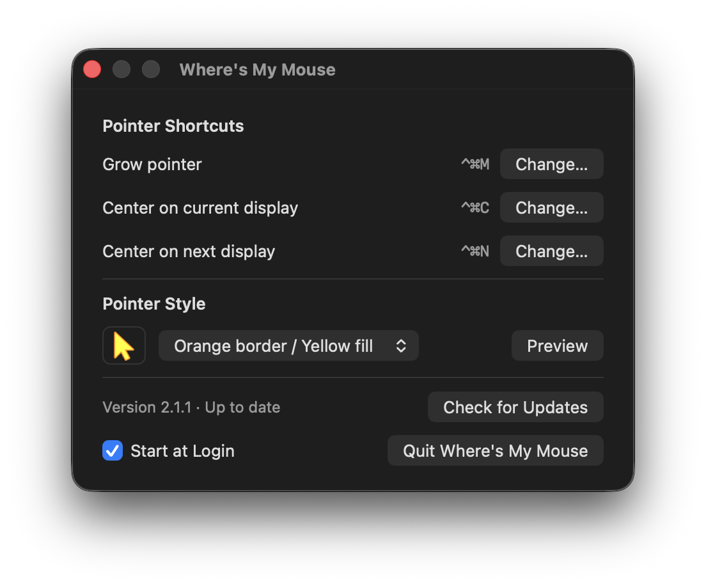
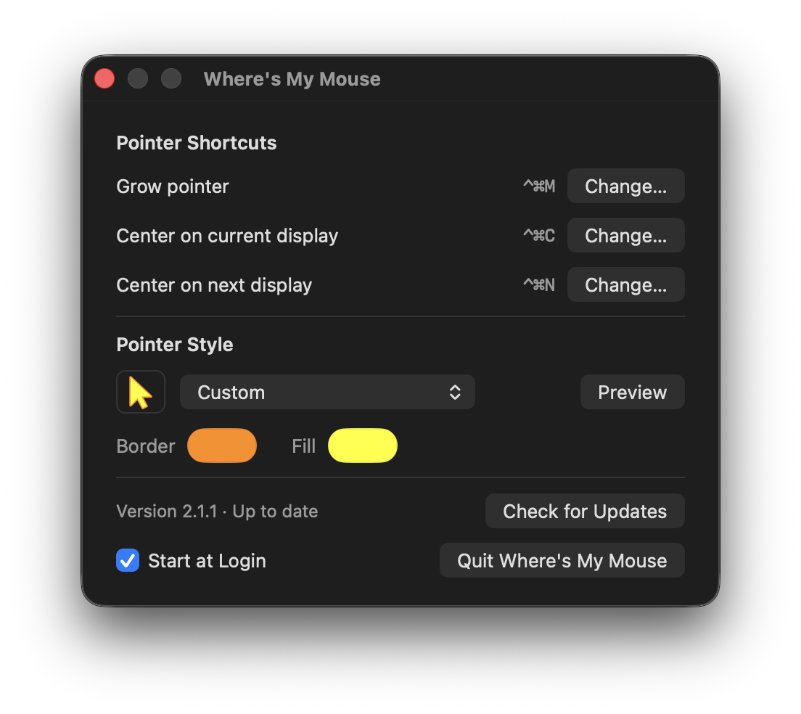

# Where's My Mouse

A small native macOS app for finding and moving the pointer with global shortcuts. No Input Monitoring or Accessibility permission is required.

| Action | Default shortcut |
| --- | --- |
| Grow the pointer | Control–Command–M |
| Center on the current display | Control–Command–C |
| Move to the next display’s center | Control–Command–N |

The grow shortcut animates a large, colored pointer highlight over 0.3 seconds and holds it for 1.5 seconds. Both center shortcuts show the full-size highlight for 1.5 seconds after moving the pointer. The next-display shortcut cycles through the connected displays and centers on the current display if there is only one. Each shortcut can be changed independently in the settings window.

## Screenshots





## Install

Where's My Mouse runs on macOS 13 or later, on both Apple Silicon and Intel. You don't need Xcode to install it.

### Homebrew

```sh
brew install --cask yz778/tap/wheresmymouse
```

### Manual download

1. Download `wheresmymouse-<version>-macos-universal.zip` from [GitHub Releases](https://github.com/yz778/wheresmymouse/releases), not the source code ZIP.
2. Unzip it, drag `wheresmymouse.app` to Applications, and open it.

The app is ad-hoc signed, not notarized. If macOS blocks it and you trust the download, go to **System Settings → Privacy & Security → Open Anyway** after trying to open it. See [Apple's instructions](https://support.apple.com/en-us/102445).

## Use

Close the window to keep the shortcuts active. Open Where's My Mouse again to edit them or choose **Quit Where's My Mouse**. Enable **Start at Login** to start it in the background at sign-in.

Choose **Pointer Style** to set the border and fill for all three shortcuts: orange/yellow (default), purple/green, red/white, or **Custom**. Custom colors are saved even when you switch to a preset. **Preview** animates the current style without moving the pointer. The system pointer stays visible and the highlight doesn't intercept clicks.

Only one copy runs per macOS user. Opening the app normally again brings its settings forward. The app checks GitHub's latest public release on launch and when you choose **Check for Updates**. **View Release** opens the release page; nothing is downloaded or installed automatically.

## Uninstall

1. Turn off **Start at Login** in the app, then choose **Quit Where's My Mouse**.
2. If installed with Homebrew, run `brew uninstall --cask yz778/tap/wheresmymouse`. Otherwise, move `wheresmymouse.app` to the Trash.
3. If it still appears under **System Settings → General → Login Items**, remove it there.
4. Optional: To erase saved shortcuts and pointer styles, run `defaults delete local.wheresmymouse.app` in Terminal after quitting the app.

## Build from source

Building from source requires macOS 13 or later and the Xcode command-line tools.

```sh
./scripts/build.sh "$HOME/Applications/wheresmymouse.app"
open "$HOME/Applications/wheresmymouse.app"
```

Run the regression tests with `bash scripts/test.sh`.

## Releases

### GitHub Actions

The macOS workflow runs the regression tests and verifies a universal ZIP on pull requests and pushes to `main`. The ZIP is available as the `macos-release` artifact on each run.

For a release, update `CFBundleShortVersionString` and increment `CFBundleVersion` in `Resources/Info.plist` in the pull request. Once merged, the workflow publishes the verified ZIP as a GitHub Release with a matching `v` tag, downloads it to compute its SHA-256, and updates the [Homebrew cask](https://github.com/yz778/homebrew-tap/blob/main/Casks/wheresmymouse.rb). Merging without a version bump does not create another release.

Publishing uses the app repository's `GITHUB_TOKEN`. The cask update uses `HOMEBREW_TAP_DEPLOY_KEY`, an Actions secret in this repository holding the private half of a write deploy key for `yz778/homebrew-tap` only. If the tap update fails after publishing, re-run the failed workflow job to reuse the published ZIP; don't overwrite the release.

### Local build

Run this on a Mac with the Xcode command-line tools:

```sh
./scripts/release.sh
```

Unlike `./scripts/build.sh`, which builds for the current Mac without changing the version, `./scripts/release.sh` increments the patch version and build number. It builds for Apple Silicon and Intel and writes a ZIP to `build/` (for example, `build/wheresmymouse-2.1.1-macos-universal.zip`). It updates `Resources/Info.plist` only after the ZIP is ready. Use `./scripts/release.sh --current` to package the existing version without changing it. Neither command commits, tags, or uploads anything.
